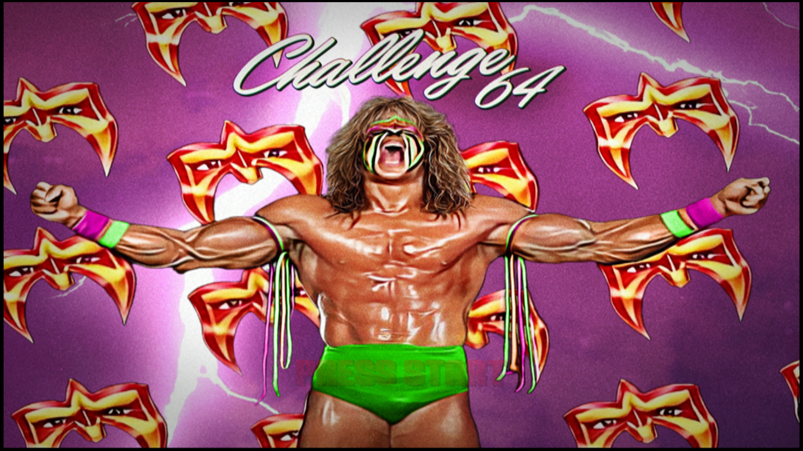
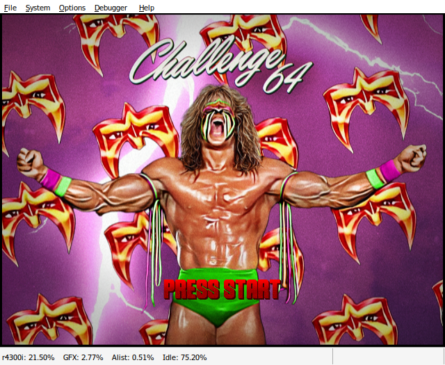

# WWF Legends - Challenge 64 Ubuntu Setup

Ubuntu setup guide and helper scripts for running an existing, lawfully
obtained copy of WWF Legends - Challenge 64 with Wine and Project64.

**This repository contains setup code, documentation, and illustrative screenshots only.** It does not
include the game, ROM, Project64, plugins, textures, cheat files, saves, or
soundtrack. You must obtain those files separately, and only from a source
authorized to distribute them. The soundtrack is required for the mod's
music; it is not optional.

## Screenshots

These captures show the verified Ubuntu/Wine setup, not Batocera.

### Borderless fullscreen

The game image fills the 1920x1080 display after texture loading, with the
emulator's menu and status bar hidden.



### Windowed mode

Launching with `WWF_LEGENDS_WINDOWED=1` keeps the emulator menus and status
bar available for settings and controller configuration.



**Third-party rights notice:** Screenshots are included to illustrate this
setup. Game artwork, characters, logos, trademarks, and emulator UI depicted
belong to their respective rights holders and are not licensed under this
repository's MIT License. Inclusion does not imply endorsement or grant
permission to reuse the depicted third-party content.

## Getting the files

For project information, visit the
[WWF Legends 64 project website](https://wwflegends64.wixsite.com/wwflegends).
The project's Downloads page describes the full base-game package and the
separate music pack. This repository does not redistribute those files or
link directly to downloads that appear to contain copyrighted game content.
Check the source's terms and your rights before obtaining or using any files.

## Quick start

1. Install Wine, GStreamer/MP3 support, and Winebundle as described in
   [SETUP.md](SETUP.md).
2. Clone this repository, then obtain the game files and required soundtrack
   separately.
3. In the cloned repository folder, place the complete supplied `Project64`
   folder, keeping its internal folder structure intact. In particular, the
   soundtrack MP3s must be under `Project64/Music Tool/Music/`.
4. Build the small borderless-fullscreen helper once, then run setup from
   the cloned repository folder:

   ```sh
   sudo apt install gcc-mingw-w64-i686
   sh build-borderless.sh
   python3 setup-ubuntu.py
   ```

5. Launch **WWF Legends - Challenge 64** from your application menu.

The helper checks for required game files and at least one soundtrack MP3
before creating a Wine prefix. Read [SETUP.md](SETUP.md) for all prerequisites,
controller setup, backups, logs, and troubleshooting.

The local `Project64/` folder is deliberately ignored by Git so game files are
not accidentally staged. It is still read by the setup helper on your
computer.

## Export to Batocera

After completing the Ubuntu setup, close Project64 and run:

```sh
python3 export-batocera.py --output "$HOME/wwf-legends-batocera-export"
```

Copy the entire export folder directly into Batocera's `/userdata`, then run
its one-time installer and refresh the game list. Start **WWF Legends - Challenge 64**
from **Ports**, not Windows. The export includes your installed Project64
configuration, saves, textures, and required soundtrack, plus a launcher
that runs the same native music helper. It does not copy Ubuntu's Wine
registry or system libraries; Batocera initializes its own prefix.

This targets **Batocera 43+ on x86-64 PCs** and is experimental until
verified on your machine. Winebundle is not required on Batocera. See
[SETUP.md](SETUP.md#export-to-batocera-experimental) for transfer instructions,
the target dependency check, controller setup, and limitations.

Exports contain your locally supplied game/media files. Keep them private;
do not publish them or commit them to this repository.

## Files in this repository

- `SETUP.md` — detailed start-to-finish Ubuntu instructions
- `setup-ubuntu.py` — creates a dedicated Wine prefix and menu launcher
- `launch-ubuntu.py` — starts Project64, selects graphics, and plays the
  soundtrack through GStreamer
- `enable-fullscreen.py` — manages Project64's native fullscreen preference
- `borderless.c`, `borderless.py`, `build-borderless.sh` — build and invoke
  our Wine-native borderless helper; no game code is included
- `export-batocera.py` — exports an installed Ubuntu game as a self-contained folder
- `install-batocera.py` — registers the copied export in Batocera's Ports menu
- `launch-batocera.py` — checks Batocera dependencies and launches the export
- `legends_runtime.py` — shared emulator-memory and GStreamer soundtrack helper

The Ubuntu launcher enters borderless fullscreen after texture loading and
renders at the primary display's resolution. Exit with **Alt+F4**. To access
the emulator's menus and settings, start in windowed mode:

```sh
WWF_LEGENDS_WINDOWED=1 ~/.local/bin/wwf-legends
```

This resets Rice's windowed rendering size to 640x480 for that launch.
The launcher disables Project64's conflicting native automatic-fullscreen flag.

## Development checks

Run the focused tests without installing additional packages:

```sh
python3 -m unittest discover -s tests -v
```

## License

The setup code and documentation in this repository are licensed under the
[MIT License](LICENSE).

This license does not cover third-party content depicted in the
[screenshots](#screenshots) or separately obtained game files, ROMs,
Project64, plugins, textures, music, or other third-party assets. Those remain
subject to their respective owners' rights and licenses.
